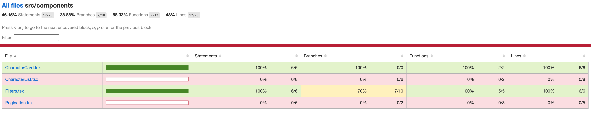

# Rick & Morty — Microfrontends

App de microfrontends con Webpack 5 Module Federation que consume la
[Rick and Morty API](https://rickandmortyapi.com/). Un host (shell) orquesta dos remotes:
el listado de personajes con filtros y el detalle de cada uno con sus episodios.

Los tres microfrontends ya están integrados: desde el listado se navega al detalle y de
vuelta, todo bajo el mismo layout del shell.

## Qué hace

- Listado de personajes con **búsqueda por nombre**, filtros por **estado** y **especie**, y
  **paginación**. Los filtros se reflejan en la URL (se pueden compartir/recargar).
- Vista de **detalle** de un personaje: información ampliada y la lista de **episodios** en los
  que aparece.
- **Navegación entre microfrontends** orquestada por el shell (el host es el dueño del router).
- **Diseño responsivo** (Tailwind) y manejo de **estados de carga y error** en cada vista.
- **Aislamiento de fallos**: si un remote no carga, un *error boundary* muestra un mensaje
  acotado en lugar de tumbar toda la app.

## Arquitectura

Son tres apps independientes dentro de `apps/`:

- **shell** (puerto 3000) — host. Monta el router, el header, el footer y el layout común.
- **characters** (puerto 3001) — remote. Listado de personajes con filtros.
- **character-detail** (puerto 3002) — remote. Detalle de un personaje y sus episodios.

El shell consume a los remotes vía Module Federation: en runtime descarga el
`remoteEntry.js` de cada uno y monta sus componentes. `react`, `react-dom` y
`react-router-dom` van como `shared` singleton para no acabar con varias copias de React
en el navegador.

```
http://localhost:3000 (shell)
  /characters            → characters (:3001)
  /character-detail/:id  → character-detail (:3002)
```

## Stack

- React 18 + TypeScript
- Webpack 5 + Module Federation
- React Router (en el shell)
- Tailwind CSS
- Docker + Nginx para el despliegue

## Estructura

```
apps/
  shell/              host (3000)
  characters/         remote (3001)
  character-detail/   remote (3002)
docker-compose.yml
```

## Correr en local (desarrollo)

Para desarrollo con hot reload. Necesitas los tres microfrontends levantados a la vez.

1. Instalar dependencias (una sola vez), desde la raíz del proyecto:

   ```bash
   npm install            # dependencias de la raíz (concurrently)
   npm run install:all    # dependencias de los tres microfrontends
   ```

2. Levantar los tres a la vez (shell + characters + character-detail), desde la raíz:

   ```bash
   npm run dev:all
   ```

3. Abrir [http://localhost:3000](http://localhost:3000).

`dev:all` usa [`concurrently`](https://www.npmjs.com/package/concurrently) para arrancar los
tres dev servers en una sola terminal, con la salida de cada uno etiquetada por color
(`shell`, `characters`, `detail`). Para pararlos: `Ctrl+C`.

> El shell carga los remotes desde `:3001` y `:3002`. Si levantas solo el shell, la lista y el
> detalle no se montan (aparecerá el mensaje del error boundary). Para desarrollo completo,
> usa `dev:all`.

Si prefieres levantar uno solo (por ejemplo para trabajar aislado en un remote):

```bash
cd apps/characters
npm start
```

Scripts por microfrontend (dentro de `apps/<mf>`):

- `npm start` — dev server con hot reload
- `npm run build` — build de producción
- `npm test` — pruebas (en `characters`)

## Pruebas

Las pruebas están en `characters` (Jest + React Testing Library). Cubren el render de las
tarjetas de personaje y el comportamiento de los filtros.

1. Entrar al remote y, si no lo has hecho, instalar dependencias:

   ```bash
   cd apps/characters
   npm install
   ```

2. Correr las pruebas:

   ```bash
   npm test
   ```

3. (Opcional) Ver el reporte de cobertura:

   ```bash
   npm test -- --coverage
   ```

   Genera un resumen en la terminal y un reporte HTML navegable en
   `apps/characters/coverage/lcov-report/index.html`.



## Levantar con Docker

La forma más simple de ver la app completa sin instalar Node ni nada a mano. Solo necesitas
Docker instalado y corriendo.

1. Desde la raíz del proyecto, construir y levantar los tres servicios:

   ```bash
   docker-compose up --build
   ```

   La primera vez tarda unos minutos (descarga las imágenes base y compila cada MF).

2. Abrir [http://localhost:3000](http://localhost:3000).

3. Para parar y eliminar los contenedores:

   ```bash
   docker-compose down
   ```

Comandos útiles:

- Levantar en segundo plano (sin ocupar la terminal): `docker-compose up -d --build`
- Ver el estado de los contenedores: `docker-compose ps`
- Si cambiaste algo y no se refleja, reconstruir sin caché:
  `docker-compose build --no-cache` y luego `docker-compose up`

## API

[Rick and Morty API](https://rickandmortyapi.com/), endpoint
`https://rickandmortyapi.com/api/character`. Tiene paginación y búsqueda por query string,
y la relación entre personajes y episodios se usa en la vista de detalle.
